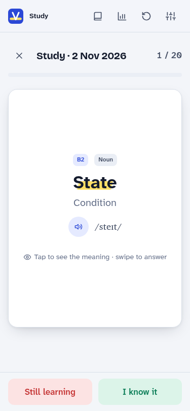

# VocabStudy

**Learn English vocabulary that stays.** Study a word set each day, then
**recall** it on spaced days — 1, 3, 7, 14, 30, 60 days later — so it moves
into long-term memory. Made for Arabic speakers (B1–C1), built to be used for
hours a day, on desktop and phone.

**Use it online and install it on your phone:**
**https://nagdista-dev.github.io/vocabstudy/** — then *Install app* /
*Add to Home Screen*. It works offline after the first visit.

Or download the repo and double-click `index.html` — no server needed.


## Features

**Remember, not just recognise**
- **Daily recall** (active recall + spaced repetition, Leitner boxes): see the
  meaning or a sentence with a gap, bring the English word back from memory,
  grade yourself. The tab title shows what's due: `(12) VocabStudy`.
- **Tricky words**: words you keep missing get their own focused practice.
- **Recall forecast** for the next 7 days.

**Learn each day's set**
- A learning path: **Study cards** → **Quiz** → **Spell** → **Match**.
- Quiz with 5 question types: meaning, Arabic → English, English → Arabic,
  fill the gap, and **listening**. Every answer shows the full word.
- **Practise your mistakes** straight after a round.
- Spelling from sound with letter-by-letter feedback.
- **Your own notes** on any word (a memory trick, a personal sentence).

**Study for hours, comfortably**
- Light, calm design; **Atkinson Hyperlegible** so look-alike letters
  (l I 1, rn m) are never confused; Arabic sized for easy reading.
- Break reminders, active study time, daily goal, streak.
- Responsive animation and soft synthesised sound effects (both optional).
- Full keyboard control; swipe cards on phones.

**Everything else**
- **Add words in the app**: paste a table from Excel, Google Sheets or
  Notion; columns are recognised automatically, every row is checked, empty
  definitions and IPA can be filled from a free dictionary. Save on the device
  or download the data file for the project.
- **Library**: every word from every day — search English, Arabic or your
  notes; sort by weakest.
- **Progress**: study time, answers, mastered words, memory strength.
- **Print or save as PDF** — 7 layouts: word sheet, compact list, fold-over
  self-test, fill-the-gap worksheet, matching worksheet, write-your-own-sentence,
  double-sided cut-out cards. Choose one or many days, due or tricky words,
  filters, order, fields and answer keys.
- **Installable app (PWA)** that works offline.
- Back up and restore your progress as a file.



## Daily use

1. Open `index.html`. The top says what to do now: recall what's due, or
   study the newest set.
2. New set → open its day → follow the learning path.
3. Every day after → **Start recall**.

Keyboard: `Space` flip / reveal · `1`–`4` answer · `Enter` next · `/` search.

## Add your own words

**In the app:** press **+** (Add words), paste your table, check, save.

**In the project** (permanent, part of the repo):

```bash
python3 tools/new_day.py 2026-11-16    # creates data/days/2026-11-16.js
# add your words, then:
python3 tools/build.py                 # checks them and builds the pages
```

```js
{ word: "Thrive", type: "Verb", level: "B2", ipa: "/θraɪv/",
  definition: "To grow or do well.", example: "I thrive when I have a clear plan.",
  arabic: "يزدهر - ينجح وينمو" },
```

`sense` is optional — use it when one word appears with two meanings:
`word: "Axe", sense: "tool"` and `word: "Axe", sense: "fire"`.
`tools/check.py` warns about duplicates, missing fields and examples that
don't contain their word.

## Project map

```text
index.html, days/*.html   generated pages — don't edit (tools/build.py)
data/days/*.js            the words, one file per day   ← edit these
data/words.js             all days joined (generated)
assets/css/               tokens → base → components → screens → motion
assets/js/core/           data, progress (SRS), speech, sounds, practice rules
assets/js/views/          one file per screen
assets/js/app.js          routing, app bar, settings, keyboard
tools/                    build · check · new_day · build_icons · screenshots · templates
manifest.webmanifest, sw.js   installable app + offline cache (sw.js is generated)
docs/                     architecture, design, learning guide
```

## Docs

| File | Read it to… |
| --- | --- |
| [docs/ARCHITECTURE.md](docs/ARCHITECTURE.md) | understand how the app boots, routes and schedules recall |
| [docs/DESIGN.md](docs/DESIGN.md) | change colours, fonts, spacing, motion or sounds safely |
| [docs/LEARN.md](docs/LEARN.md) | learn web development from this codebase (Arabic) |
| [CONTRIBUTING.md](CONTRIBUTING.md) | send an improvement |

## Your data

Progress lives only in your browser (localStorage) — nothing is sent
anywhere. **Settings → Back up progress** downloads it as a file;
**Restore from file** loads it on another browser or device.

## License

[MIT](LICENSE) — use it, change it, share it.
