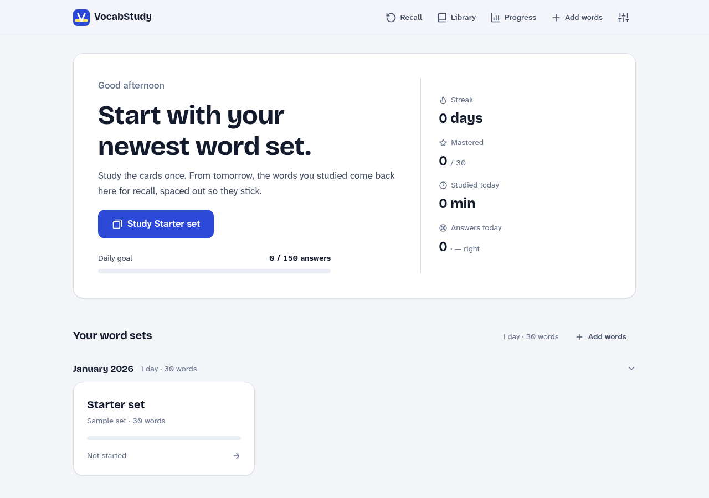
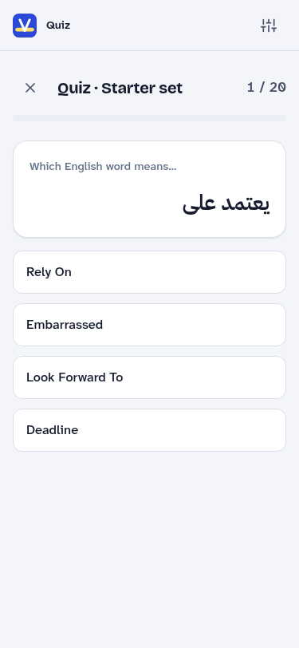

# VocabStudy

**A free app for Arabic speakers learning English vocabulary — words you
add yourself, remembered for good.** Add your words, study them once, then
**recall** them on spaced days (1, 3, 7, 14, 30, 60 days later) so they move
into long-term memory.

**Open it: https://nagdista-dev.github.io/vocabstudy/** — then
*Install app* / *Add to Home Screen*. No account, no ads, works offline.
Your words and progress stay on your device.



## How it works

1. **Add your words** (+ Add words) — three ways:
   - **Type a word**: only the English word and its Arabic meaning are needed;
     *Fill* looks up the definition and IPA in a free dictionary.
   - **Paste a table** from Excel, Google Sheets or Notion — columns are
     recognised automatically and every row is checked.
     Try [`data/sample/sample-import.tsv`](data/sample/sample-import.tsv).
   - **Upload files**: `.tsv` / `.csv` tables, or VocabStudy `.js` sets.
2. **Study** each set once: **Cards → Quiz → Spell → Match**.
3. **Recall** every day: the home screen shows what's due, and the tab title
   too: `(12) VocabStudy`.

Not ready to add words yet? Open the built-in **Starter set**: 30 words
Arabic speakers often mix up (borrow / lend, affect / effect, actually ≠ حالياً).

## Features

**Remember, not just recognise**
- Daily **recall** (active recall + spaced repetition): from the meaning or
  from a sentence with a gap — you bring the English word back yourself.
- **Tricky words**: the ones you keep missing get their own practice.
- Recall **forecast** for the next 7 days.

**Learn**
- Study cards (English-first or Arabic-first), swipe on phones.
- Quiz with 5 question types incl. **listening**; every answer shows the full word.
- Spelling from sound with letter-by-letter feedback.
- **Practise your mistakes** straight after a round.
- **Notes** on any word: your own memory trick.

**Made for long study days**
- Calm light design; **Atkinson Hyperlegible** so look-alike letters
  (l I 1, rn m) are never confused; Arabic sized for easy reading.
- Break reminders, real study time, daily goal, streak.
- Responsive animation and soft sound effects (both optional).
- Full keyboard control; bottom navigation on phones.

**Your words, your way**
- **Library**: search everything (English, Arabic, your notes), sort by weakest.
- **Edit or delete** any word you added; editing keeps its progress.
- **Progress** charts: study time, answers, mastered words, memory strength.
- **Download PDF** or print — 7 layouts: word sheet, compact list, fold-over
  self-test, fill-the-gap and matching worksheets, write-a-sentence, and
  double-sided cut-out cards. Pick days, filters, order and fields.
- **Backup & export**: one-file backup, restore by merge or replace,
  CSV for Excel, copy as table.
- Settings: US/UK voice, speed, card direction, quiz types, round size,
  daily goal, break reminder, accent colour, text size.

 

Keyboard: `Space` flip / reveal · `1`–`4` answer · `Enter` next · `/` search.

## Your data

Everything lives in your browser (localStorage) — nothing is sent anywhere.
About 20,000 words fit. **Backup & export** saves it all to one file;
restore it on another device, or merge phone and laptop.

## Run it yourself

No install needed: download the repo and open `index.html`. To change the
code, rebuild after editing:

```bash
python3 tools/build.py    # checks everything and writes index.html, data/words.js, sw.js
python3 tools/check.py    # data, missing files, unstyled classes, duplicated helpers
```

```text
index.html, data/words.js, sw.js   generated — don't edit (tools/build.py)
data/sample/              the Starter set and a sample import table
assets/css/               tokens → base → components → screens → motion
assets/js/core/           data, progress (spaced repetition), speech, sounds, importer
assets/js/views/          one file per screen
assets/js/app.js          routing, navigation, settings, keyboard
tools/                    build · check · build_icons · screenshots · templates
docs/                     architecture, design, learning guide
```

| Read | to… |
| --- | --- |
| [docs/ARCHITECTURE.md](docs/ARCHITECTURE.md) | understand how the app boots, routes and schedules recall |
| [docs/DESIGN.md](docs/DESIGN.md) | change colours, fonts, spacing, motion or sounds safely |
| [docs/LEARN.md](docs/LEARN.md) | learn web development from this codebase (Arabic) |
| [CONTRIBUTING.md](CONTRIBUTING.md) | send an improvement |

## License

[MIT](LICENSE) — free to use, change and share.
